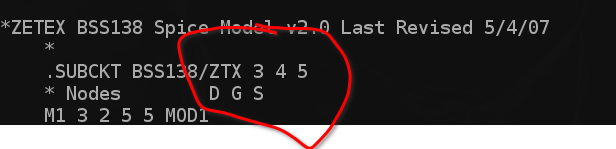

# LTspice 


## How to add custom symbols/components

Refer to https://www.youtube.com/watch?v=YHJPhDUSvX0

This also tells how to make imported models look like stock one. e.g. bss138

The below is the guidelines on ltspice running on linux

* Download the bss138 spice model from internet 
* copy the bss138.spice or bss138.sub into your project directory
* open the bss138.spice or bss138.sub and go to `.subckt` line and click create circuit
* this will generate an autogenerated file under following dir
```
~/Documents/LTspiceXVII/lib/sym/AutoGenerated$ ls
BSS138_ZTX.asy

```

* this one looks ugly and not like a nmost
* open nmos.asy in ~/Documents/LTspiceXVII/lib/sym/
* copy following lines which make the diagram
```
:~/Documents/LTspiceXVII/lib/sym$ cat nmos.asy 
Version 4
SymbolType CELL
LINE Normal 48 48 48 96
LINE Normal 16 80 48 80
LINE Normal 40 48 48 48
LINE Normal 16 48 40 44
LINE Normal 16 48 40 52
LINE Normal 40 44 40 52
LINE Normal 16 8 16 24
LINE Normal 16 40 16 56
LINE Normal 16 72 16 88
LINE Normal 0 80 8 80
LINE Normal 8 16 8 80
LINE Normal 48 16 16 16
LINE Normal 48 0 48 16
WINDOW 0 56 32 Left 2
WINDOW 3 56 72 Left 2
SYMATTR Value NMOS
SYMATTR Prefix MN
SYMATTR Description N-Channel MOSFET transistor
PIN 48 0 NONE 0
PINATTR PinName D
PINATTR SpiceOrder 1
PIN 0 80 NONE 0
PINATTR PinName G
PINATTR SpiceOrder 2
PIN 48 96 NONE 0
PINATTR PinName S
PINATTR SpiceOrder 3
```

Copy 
```
LINE Normal 48 48 48 96
LINE Normal 16 80 48 80
LINE Normal 40 48 48 48
LINE Normal 16 48 40 44
LINE Normal 16 48 40 52
LINE Normal 40 44 40 52
LINE Normal 16 8 16 24
LINE Normal 16 40 16 56
LINE Normal 16 72 16 88
LINE Normal 0 80 8 80
LINE Normal 8 16 8 80
LINE Normal 48 16 16 16
LINE Normal 48 0 48 16
```
and add it into BSS138_ZTX.asy

```
~/Documents/LTspiceXVII/lib/sym/AutoGenerated$ cat BSS138_ZTX.asy 
Version 4
SymbolType BLOCK
LINE Normal 48 48 48 96
LINE Normal 16 80 48 80
LINE Normal 40 48 48 48
LINE Normal 16 48 40 44
LINE Normal 16 48 40 52
LINE Normal 40 44 40 52
LINE Normal 16 8 16 24
LINE Normal 16 40 16 56
LINE Normal 16 72 16 88
LINE Normal 0 80 8 80
LINE Normal 8 16 8 80
LINE Normal 48 16 16 16
LINE Normal 48 0 48 16
WINDOW 0 24 -12 Bottom 2
WINDOW 3 131 77 Top 2
SYMATTR Value BSS138/ZTX
SYMATTR Prefix X
SYMATTR ModelFile Z:\home\ami\work\repos\kicad-pcbs\learning\ltspice\level_shifter\BSS138.spice
PIN 48 0 RIGHT 8
PINATTR PinName 3
PINATTR SpiceOrder 1
PIN 0 80 RIGHT 8
PINATTR PinName 4
PINATTR SpiceOrder 2
PIN 48 96 RIGHT 8
PINATTR PinName 5
PINATTR SpiceOrder 3
```
open the BSS_ZTX.asy again in ltspice and arrange the pin number based on base spice model: bss138.spice



Arrange 3, 4 and 5 accordingly
