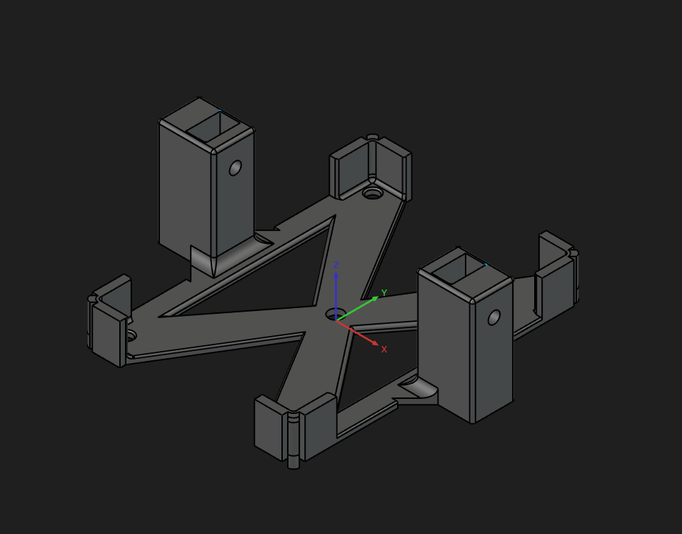
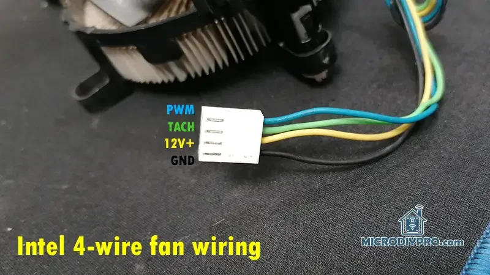

# RPI5 cooling

## RPi5 intel fan case

- rpi5 P573 metallic case
    https://wiki.geekworm.com/P573

    

- print the rpi5-fan-case-redo-Body.step only

## Intel 4 wire fan details

- 4 wire pwm fan
- model: `e97378`
- https://microdiypro.com/intel-4-wire-pwm-fan-specification-25khz-open-collector/
- https://microdiypro.com/control-a-4-wire-pc-fan-using-esp8266/

- Wiring
    * Black – Ground (GND)
    * Yellow – +12 V (constant power)
    * Green – TACH output (open‑collector, 2 pulses per revolution)
    * Blue – PWM control input

5.1 DELTA E97378‑001
0% PWM: ~990 RPM
30% PWM: ~1290 RPM
50% PWM: ~1500 RPM
100% PWM: ~1980 RPM
This fan enforces a clear minimum speed and never stops.

5.2 NIDEC E97378‑001 (Used Fan)
0% PWM: 1140–1380 RPM
30% PWM: 1200–1500 RPM
50% PWM: 1200–1500 RPM
65% PWM: 1590–1890 RPM
80% PWM: 1830–2160 RPM
100% PWM: 2500–2800 RPM

All experiments were performed using:

ESP8266 microcontroller
25 kHz open‑drain PWM output
Direct +12 V fan supply
RPM measured via TACH output
The following was verified experimentally:

PWM pin floats high when disconnected (~3.5–4 V)
Connecting PWM to GND lowers speed but does not stop the fan
Disconnecting the TACH wire has no effect on fan behavior

